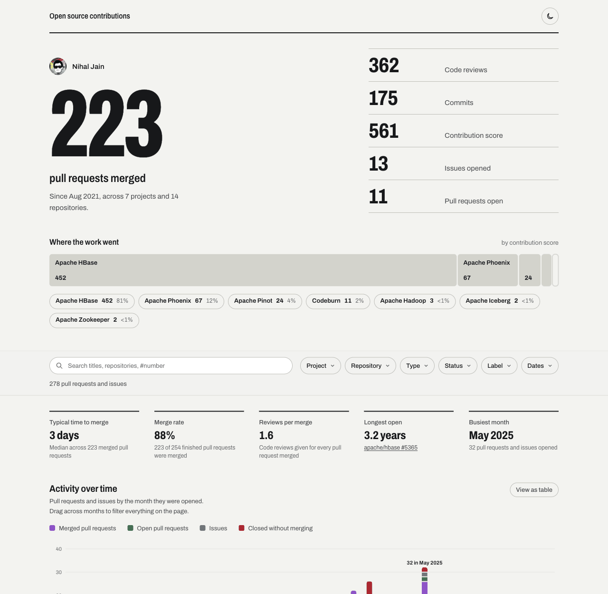

# OpenSource Contributions Tracker

A tool that fetches contribution data from the GitHub API and produces a rich markdown report for one user or a whole
team. Designed for developers and organizations who want a centralized, automated view of their open-source activity.

## Features

Tracks the following metrics across all configured repositories for each user, within a configurable date range:

| Metric | Description |
|--------|-------------|
| **Commits** | Commits merged into the default branch |
| **Pull Requests (Open / Closed)** | PRs authored by each user |
| **Issues (Open / Closed)** | Issues opened by each user |
| **Code Reviews** | Unique PRs formally reviewed (`reviewed-by:`) |
| **Lines Added / Removed** | Line-level changes for merged commits and open PRs, with optional refactor filtering |

The report includes:
- Overall summary table with totals for every metric
- Per-project and per-user contribution breakdowns with pie charts
- Detailed row-level table (project / repository / user / rank / all metrics)
- Activity detail section listing every individual PR and issue with status, dates, and labels

You control which metrics count toward the **Overall Contribution** score via `contribution_config`.

## How it works

1. **Data retrieval** — fetches commits, PRs, issues, code reviews, and (optionally) per-commit/per-PR line stats from the GitHub REST API, handling pagination and rate-limit headers automatically.
2. **Data processing** — aggregates raw counts per user per repository, applies the `contribution_config` scoring weights, and optionally filters large refactor commits/PRs via `refactor_threshold`.
3. **Report generation** — writes `output/github_contributions_report.md` (markdown), `output/github_contribution_data.csv` (raw data), and two PNG pie charts.
4. **Automated execution** — a GitHub Actions workflow runs the report on a schedule and commits the output. See [GitHub Actions](#github-actions-automated-workflow).

## Quick start (fork & go)

1. **Fork this repository.**
2. **Edit `input/github.json`** — set `start_date`, add your GitHub usernames, and either map projects to repositories or leave `project_to_repo_dict` empty to have them [auto-detected](#auto-detected-repositories-empty-project_to_repo_dict). See [Configuration](#configuration) for all options.
3. **Push the changes** — the GitHub Actions workflow will run automatically on the next scheduled cycle, or you can [trigger it manually](#steps-to-trigger-the-workflow-manually).
4. **View the report** — open `output/github_contributions_report.md` in the repository.

> **Local run**: skip steps 3–4 and run `python generate_report.py` after completing the [Local Setup](#local-setup).

## Demo

A live sample report is available at [output/github_contributions_report.md](output/github_contributions_report.md).
It shows the full report structure: summary table, pie charts, per-project and per-user breakdowns, and the activity
detail section with individual PRs and issues.

## Dashboard

An interactive web dashboard for the same data lives in [`dashboard/`](dashboard/README.md). It leads with the
headline numbers (merged pull requests, code reviews, commits, contribution score), shows where the work went and how
it moved over time, and lets you filter and share any view as a link.



It is a static site built from the report in `output/`, so it can be hosted on any static host. The repository
publishes it to GitHub Pages by default, with an optional Cloudflare deploy. See the
[dashboard README](dashboard/README.md) for local development and hosting your own copy.

## Local Setup

### Prerequisites

- Python 3.10+
- A GitHub personal access token that can read public repositories (a fine-grained token with no extra
  permissions, or the classic `public_repo` scope). Set it as the `GITHUB_TOKEN` environment variable.
  Do not give it access to private repositories unless you need them: see [Private repositories](#private-repositories).

### Installation

1. **Clone the repository**:
    ```sh
    git clone https://github.com/NihalJain/opensource-contributions-tracker.git
    cd opensource-contributions-tracker
    ```

2. **Install dependencies**:
    ```sh
    pip install -r requirements.txt
    ```

3. **Set environment variables**:
    ```sh
    export GITHUB_TOKEN=your_personal_access_token
    # Optional — only needed if behind a corporate proxy:
    export HTTP_PROXY=http://proxy.example.com:8080
    export HTTPS_PROXY=http://proxy.example.com:8080
    ```

### Configuration

The input file is `input/github.json`. The only required fields are `start_date` and `users`.

**Minimal structure (single contributor, all repositories auto-detected):**
```json
{
    "start_date": "YYYY-MM-DD",
    "users": ["user1"]
}
```

#### Auto-detected repositories (empty `project_to_repo_dict`)

Leave `project_to_repo_dict` out, or set it to `{}`, and the generator finds the repositories itself. Both of these
are equivalent:

```json
{
    "start_date": "2024-01-01",
    "users": ["user1", "user2"],
    "project_to_repo_dict": {}
}
```

For every user it searches the pull requests they authored, collects the repositories those pull requests were
opened against, and turns each repository into a project named after itself. With the configuration above the
effective mapping could look like this (illustrative):

```json
{
    "owner-a/repo-one": ["owner-a/repo-one"],
    "owner-a/repo-two": ["owner-a/repo-two"],
    "owner-b/tool":     ["owner-b/tool"]
}
```

Use this for a quick look at everything a person has worked on. When you want repositories grouped under
meaningful project names (for example several repositories under one product), list them explicitly as in the
full structure below.

> **Notes on auto-detection**
> - **Explicit wins.** As soon as `project_to_repo_dict` has at least one entry, only the repositories you list are
>   tracked. Discovery is not mixed in.
> - **Found through authored pull requests only.** A repository where a user only committed directly, reviewed or
>   filed issues is not discovered. List it explicitly if it matters.
> - **Up to 1 000 pull requests per user.** The GitHub Search API returns at most 1 000 results, so a very
>   prolific user can have some repositories missed. List those explicitly.
> - **The date range does not limit discovery,** it limits what is counted. A discovered repository with no
>   activity in the range simply does not appear in the report.
> - **Every repository is its own project,** so the project pie chart and project list have one entry per
>   repository.
> - **Private repositories are left out** of the discovered set under the default `private_repos: "exclude"`;
>   see [Private repositories](#private-repositories).

**Full structure:**
```json
{
    "start_date": "YYYY-MM-DD",
    "end_date": "YYYY-MM-DD",
    "contribution_config": {
        "commits":       { "enabled": true,  "count_towards_score": true  },
        "open_prs":      { "enabled": true,  "count_towards_score": true  },
        "closed_prs":    { "enabled": true,  "count_towards_score": false },
        "open_issues":   { "enabled": true,  "count_towards_score": true  },
        "closed_issues": { "enabled": true,  "count_towards_score": true  },
        "code_reviews":  { "enabled": true,  "count_towards_score": true  },
        "line_stats":    { "enabled": false, "refactor_threshold": 0.1   }
    },
    "private_repos": "exclude",
    "users": ["user1", "user2"],
    "project_to_repo_dict": {
        "Project1": ["owner/repo1", "owner/repo2"],
        "Project2": ["owner/repo3"]
    }
}
```

This block lists every key the generator reads. Only `start_date` and `users` are required; everything else
can be left out. Where the block differs from the defaults:

- `end_date` is optional and defaults to tomorrow.
- `private_repos` defaults to `"exclude"`; the other value is `"include"`. See
  [Private repositories](#private-repositories).
- `project_to_repo_dict` can be left out, or set to `{}`, to
  [auto-detect repositories](#auto-detected-repositories-empty-project_to_repo_dict).
- In `contribution_config` every metric defaults to `enabled: true` and `count_towards_score: true`. The block
  shows `closed_prs` with `count_towards_score: false`, which is a choice, not the default.
- `line_stats` defaults to `enabled: false` and has no `refactor_threshold`; `0.1` is an example value.

**Field reference:**

| Field | Required | Default | Description |
|-------|----------|---------|-------------|
| `start_date` | Yes | — | Start of the reporting period (`YYYY-MM-DD`) |
| `end_date` | No | Tomorrow | End of the reporting period (`YYYY-MM-DD`, inclusive) |
| `users` | Yes | — | List of GitHub usernames to track |
| `project_to_repo_dict` | No | Auto-detected | Maps project display names to lists of `owner/repo` strings. If omitted or `{}`, repositories are [discovered](#auto-detected-repositories-empty-project_to_repo_dict) from each user's PR history (capped at 1 000 results by the GitHub Search API) |
| `private_repos` | No | `exclude` | `exclude` leaves private repositories out of every output and log; `include` keeps them. See [Private repositories](#private-repositories) |
| `contribution_config` | No | All enabled | Per-metric configuration object. Omitting it or any key within it uses the defaults shown below |
| &nbsp;&nbsp;`commits` | No | — | Config for merged commits |
| &nbsp;&nbsp;&nbsp;&nbsp;`enabled` | No | `true` | Collect and display this metric |
| &nbsp;&nbsp;&nbsp;&nbsp;`count_towards_score` | No | `true` | Add to the Overall Contribution score |
| &nbsp;&nbsp;`open_prs` | No | — | Config for open pull requests |
| &nbsp;&nbsp;&nbsp;&nbsp;`enabled` | No | `true` | Collect and display |
| &nbsp;&nbsp;&nbsp;&nbsp;`count_towards_score` | No | `true` | Add to score |
| &nbsp;&nbsp;`closed_prs` | No | — | Config for closed pull requests |
| &nbsp;&nbsp;&nbsp;&nbsp;`enabled` | No | `true` | Collect and display |
| &nbsp;&nbsp;&nbsp;&nbsp;`count_towards_score` | No | `true` | Add to score |
| &nbsp;&nbsp;`open_issues` | No | — | Config for open issues |
| &nbsp;&nbsp;&nbsp;&nbsp;`enabled` | No | `true` | Collect and display |
| &nbsp;&nbsp;&nbsp;&nbsp;`count_towards_score` | No | `true` | Add to score |
| &nbsp;&nbsp;`closed_issues` | No | — | Config for closed issues |
| &nbsp;&nbsp;&nbsp;&nbsp;`enabled` | No | `true` | Collect and display |
| &nbsp;&nbsp;&nbsp;&nbsp;`count_towards_score` | No | `true` | Add to score |
| &nbsp;&nbsp;`code_reviews` | No | — | Config for PRs formally reviewed |
| &nbsp;&nbsp;&nbsp;&nbsp;`enabled` | No | `true` | Collect and display |
| &nbsp;&nbsp;&nbsp;&nbsp;`count_towards_score` | No | `true` | Add to score |
| &nbsp;&nbsp;`line_stats` | No | — | Config for lines added/removed. Expensive: one extra API call per commit and per open PR |
| &nbsp;&nbsp;&nbsp;&nbsp;`enabled` | No | `false` | Fetch and display line stats. Set to `false` to skip (recommended for large datasets) |
| &nbsp;&nbsp;&nbsp;&nbsp;`refactor_threshold` | No | Disabled | Float (0–1). Commits/PRs where net-change ratio is below this are excluded from line counts |

### Notes

- **Cost of a run.** A run makes a few search requests per user, then a handful of requests for each repository
  someone was active in (its details, its contributor ranking and, only for users who committed there, the
  commit listing). Repositories with no activity cost one lookup, to check that they are public. The production
  configuration (1 user, 16 repositories) takes about 70 requests and a minute. `line_stats` is the expensive
  option: it adds one request per commit and per open pull request, which is why it is off by default.
- **Search API limits.** The GitHub Search API returns at most 1 000 results per query. When a user's results are
  truncated the generator notices and falls back to per-repository queries, so counts stay exact but the run is
  slower. The log says when this happens.
- **Dates are inclusive.** Both `start_date` and `end_date` are included, and `end_date` defaults to tomorrow so
  that today's activity is counted.
- **Usernames are case-insensitive.** They are lower-cased before use.
- **Misconfiguration fails early.** A missing `start_date` or `users`, an unknown `private_repos` value, or a
  configuration with nothing public left stops the run with a message before the report is written.

### Private repositories

The report, the data files and the dashboard are normally committed to a public repository and published as a
public site, so **private repositories are excluded by default** (`"private_repos": "exclude"`):

- A repository is kept only when GitHub reports it as public. One the token cannot see, or whose visibility is
  missing from the answer, is excluded too.
- Excluded repositories are not searched, counted, ranked or named anywhere: not in the report, the CSV, the
  activity JSON, the charts, the dashboard or the logs (CI logs of a public repository are public). The log
  only says how many were excluded.
- This applies to repositories listed in `project_to_repo_dict` as well as to auto-detected ones.
- Excluded work does not count towards anyone's totals or rank.

Set `"private_repos": "include"` only when the output stays private, for example a private repository with
private hosting. A value other than `exclude` or `include` stops the run before any API call.

Running with a token that can see private repositories is safe with the default, but a token without that
access is better still: the GitHub Actions workflow's built-in `GITHUB_TOKEN` already sees only public data.

**Output files** written to `output/`:

| File | Description |
|------|-------------|
| `github_contributions_report.md` | Full markdown report |
| `github_contribution_data.csv` | Raw per-user-per-repo numeric data |
| `github_activity_data.json` | Cached PR and issue objects used for the Activity Details section |
| `project_wise_contribution.png` | Pie chart of contributions by project |
| `user_wise_contribution.png` | Pie chart of contributions by user |

**Re-generate the report from cached data** (no API calls) — both output files must exist:
```sh
# In generate_report.py, comment out generate_report() and uncomment:
generate_report_with_local_data()
```

## GitHub Actions (Automated workflow)

The repository includes a GitHub Actions workflow at `.github/workflows/main.yml` that:
- Runs automatically on a schedule (default: every 24 hours — adjust the `cron` expression to suit your needs).
- Commits the generated report and CSV back to the repository.

To update the configuration, edit `input/github.json` and push — the next workflow run picks up the changes automatically.

### Steps to trigger the workflow manually

1. Go to the **Actions** tab of your forked repository.
2. Select the **Open Source Contribution Tracker Job** workflow.
3. Click **Run workflow**, choose the branch, and confirm.
4. Once the run completes, the updated report is committed to the `output/` directory.

## Contributing

1. Fork the repository and create a feature branch:
    ```sh
    git checkout -b feature/my-improvement
    ```
2. Make your changes and verify the script runs correctly:
    ```sh
    export GITHUB_TOKEN=your_token
    python generate_report.py
    ```
3. Run the tests (they use stubbed GitHub responses and need no token):
    ```sh
    pip install -r requirements-dev.txt
    pytest
    ```
4. Commit, push, and open a pull request against `main`.

## License

This project is licensed under the Apache License 2.0. See the [LICENSE](LICENSE) file for details.

## Contact

For questions or suggestions, please [open an issue](https://github.com/NihalJain/opensource-contributions-tracker/issues)
or reach out to the repository owner [Nihal Jain](https://www.linkedin.com/in/nihaljain/).