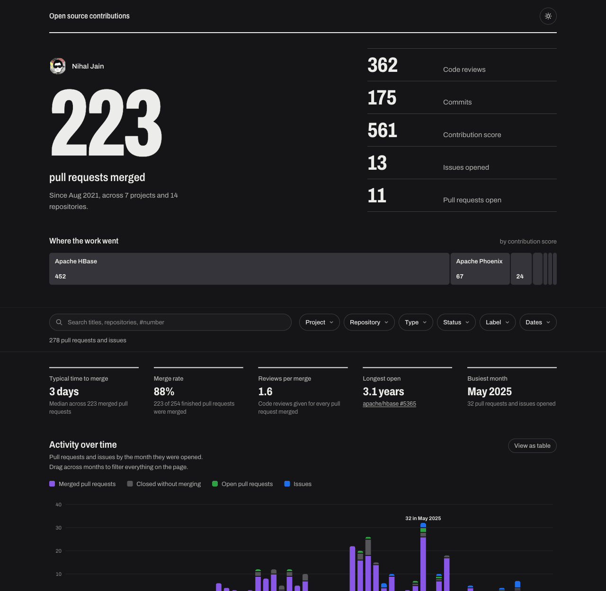

# OSS Contributions Dashboard

A fast, static dashboard for the activity the report generator collects: pull requests, issues, code reviews, commits and contribution score, across any number of projects and people.


It is a plain static site with no server and no runtime API. The data is published next to the page when the site is built, so it can be hosted anywhere that serves files.

<details>
<summary>Dark theme</summary>



</details>

---

## What it shows

- **The headline.** Merged pull requests, with code reviews, commits, contribution score, issues and open pull requests beside it. With more than one contributor it describes the team instead of a person.
- **Where the work went.** A ribbon sized by contribution score. Select a project to scope the whole page to it.
- **Highlights.** Typical time to merge, merge rate, reviews per merged pull request, the longest-open pull request, and the busiest month.
- **Activity over time.** Pull requests and issues by month and outcome. Drag across months (or use the arrow keys, Enter and Escape) to filter everything on the page.
- **Projects and repositories.** Ranked bars with drill-down to repositories and your rank among each repository's contributors.
- **How quickly pull requests merge**, and **contributors** when the report covers more than one person.
- **Every pull request and issue.** Search, sort, page, and download the filtered list as CSV.

Every chart has a **View as table** twin. The state of the page, including filters, sort and page, is kept in the address, so any view can be shared as a link. Light and dark themes follow the system setting and can be switched.

---

## How it works

```
generate_report.py
   ├─ output/github_activity_data.json     every pull request and issue
   └─ output/github_contribution_data.csv  commits, reviews, score and rank per repository
                    │
                    │  npm run build   (scripts/prepare-data.mjs)
                    ▼
   app/public/activity.json, contributions.json, meta.json
                    │
                    ▼
        app/dist/   ──►  GitHub Pages, Cloudflare, or any static host
```

The data shown is whatever was in `output/` when the site was last built. The nightly workflow regenerates the report and then redeploys the dashboard: to GitHub Pages by default, and to Cloudflare too when credentials are set. Pull requests that touch `dashboard/` build and test it as a check but never publish.

If `github_contribution_data.csv` is missing, the dashboard still works and simply hides the commit, review and score figures.

---

## Folder structure

```
dashboard/
├── README.md
├── DESIGN.md                 ← design decisions and how to change them
├── wrangler.toml             ← optional Cloudflare deploy config (static assets only)
├── docs/                     ← preview images
└── app/
    ├── site.config.json      ← the page title
    ├── scripts/              ← build-time data preparation, with tests
    ├── public/               ← favicon, robots.txt and the published data files and llms.txt
    └── src/
        ├── data/             ← types, loading, filtering, aggregation, insights (all tested)
        ├── charts/           ← SVG charts: timeline, bar list, sparkline
        ├── components/       ← hero, filters, sections, explorer
        ├── hooks/            ← data loading, URL-backed view state, theme, sizing
        └── styles/           ← design tokens and base styles
```

---

## Local development

```bash
python generate_report.py      # optional: the repository ships with a sample report in output/
cd dashboard/app
npm install
npm run dev                    # http://localhost:5173
npm test                       # unit tests for the data layer and build scripts
npm run typecheck
```

`npm run dev` and `npm run build` first run `scripts/prepare-data.mjs`, which publishes the report's files into `app/public/` (git-ignored) and writes an `llms.txt` describing the site and its data files, using the title from `site.config.json`.

---

## Configuration

| Setting | Where | Default | What it does |
|---|---|---|---|
| `title` | `app/site.config.json` | `Open source contributions` | The name shown at the top of the page and in the browser tab. |
| `ACTIVITY_DATA_FILE` | environment, at build | `../../output/github_activity_data.json` | The activity feed to publish. A relative path is resolved from `dashboard/app`. |
| `CONTRIBUTIONS_DATA_FILE` | environment, at build | `../../output/github_contribution_data.csv` | The contribution metrics to publish. |

Colours, type and spacing are CSS custom properties in `app/src/styles/tokens.css`; see [DESIGN.md](DESIGN.md) before changing them, because the chart colours were validated as a set.

---

## Hosting your own copy (fork checklist)

Nothing in this repository is tied to a specific domain or account.

1. **Fork the repository** and configure `input/github.json` (see the root README).
2. **Generate your data.** Run the **Open Source Contribution Tracker Job** workflow from the Actions tab (or `python generate_report.py` locally) so `output/` holds your feed.
3. **Publish the site.**
   - **GitHub Pages (default):** forks have workflows disabled until you enable them on the **Actions** tab. Then open **Settings → Pages → Build and deployment**, set **Source** to **GitHub Actions**, and run **Actions → Deploy Dashboard → Run workflow**. The site is served at `https://<your-user>.github.io/<repo>/` and is redeployed on every push that touches `dashboard/` and after each nightly report.
   - **Cloudflare:** follow [Deploying to Cloudflare](#deploying-to-cloudflare).
   - **Any other static host** (Netlify, S3, ...): build and upload the `dist` folder.

     ```bash
     cd dashboard/app
     npm ci
     npm run build      # output: dashboard/app/dist/
     ```

---

## Deploying to Cloudflare

The site is deployed as Workers **static assets**: `wrangler deploy` runs the `[build]` command from `wrangler.toml` (which copies the feed and builds the app) and uploads `app/dist`. No Worker script is involved.

| Method | When to use |
|--------|-------------|
| [A – CLI](#method-a--cli-wrangler-deploy) | One-off or manual deploy from your laptop |
| [B – GitHub Actions](#method-b--github-actions-automated-deploy) | Redeploy automatically after every nightly report |
| [C – Cloudflare dashboard UI](#method-c--cloudflare-dashboard-ui) | Inspect deployments, view logs, add a custom domain |

### Method A – CLI (`wrangler deploy`)

Prerequisites: a free [Cloudflare account](https://dash.cloudflare.com/sign-up) and Node.js 22+ (required by wrangler 4).

```bash
cd dashboard
npx wrangler@4 login            # once per machine; opens a browser
npx wrangler@4 deploy
```

The last lines print your URL, `https://<name>.<your-subdomain>.workers.dev`. To use a different name, change `name` in `wrangler.toml` before deploying.

| URL | Expected result |
|-----|----------------|
| `https://<url>/` | Dashboard UI loads |
| `https://<url>/activity.json` | The raw feed (JSON) |

To publish new data, regenerate the report and run `npx wrangler@4 deploy` again.

### Method B – GitHub Actions (automated deploy)

The **Deploy Dashboard** workflow (`.github/workflows/deploy-dashboard.yml`) also deploys to Cloudflare whenever both secrets exist. It runs on pushes that touch `dashboard/`, and the nightly report workflow calls it after committing fresh data. Without the secrets the Cloudflare job is skipped, with a notice in the run log.

1. **Create an API token:** [dash.cloudflare.com](https://dash.cloudflare.com) → **My Profile → API Tokens → Create Token**, choose the **Edit Cloudflare Workers** template, select your account, and copy the token.
2. **Find your Account ID:** **Workers & Pages** → copy **Account ID** from the right-hand sidebar.
3. **Add repository secrets** under **Settings → Secrets and variables → Actions**:
   - `CLOUDFLARE_API_TOKEN`
   - `CLOUDFLARE_ACCOUNT_ID`
4. **Run it once:** **Actions → Deploy Dashboard → Run workflow**.

The nightly workflow calls the deploy workflow directly because pushes made with `GITHUB_TOKEN` do not trigger other workflows.

### Method C – Cloudflare dashboard UI

Use the dashboard to manage a site already deployed with Method A or B. It cannot create the deployment itself, because uploading the built files needs `wrangler`.

| Task | Where in the dashboard |
|------|------------------------|
| View deployment history / roll back | **Workers & Pages → your project → Deployments** |
| Inspect real-time logs | **Workers & Pages → your project → Logs** |
| Add or remove a custom domain | **Workers & Pages → your project → Settings → Domains & Routes → Add Custom Domain** |
| View request analytics | **Workers & Pages → your project → Metrics** |

To add a custom domain, open **Settings → Domains & Routes → Add Custom Domain** and enter a domain that is already on Cloudflare DNS (for example `dashboard.example.com`). The certificate is provisioned automatically. The domain belongs to your Cloudflare account and is not stored in this repository.

Cloudflare's own Git integration also works: connect the repository, set the root directory to `dashboard`, and use `npx wrangler deploy` as the deploy command. It runs the same `[build]` step on every push, including the report workflow's commits.
